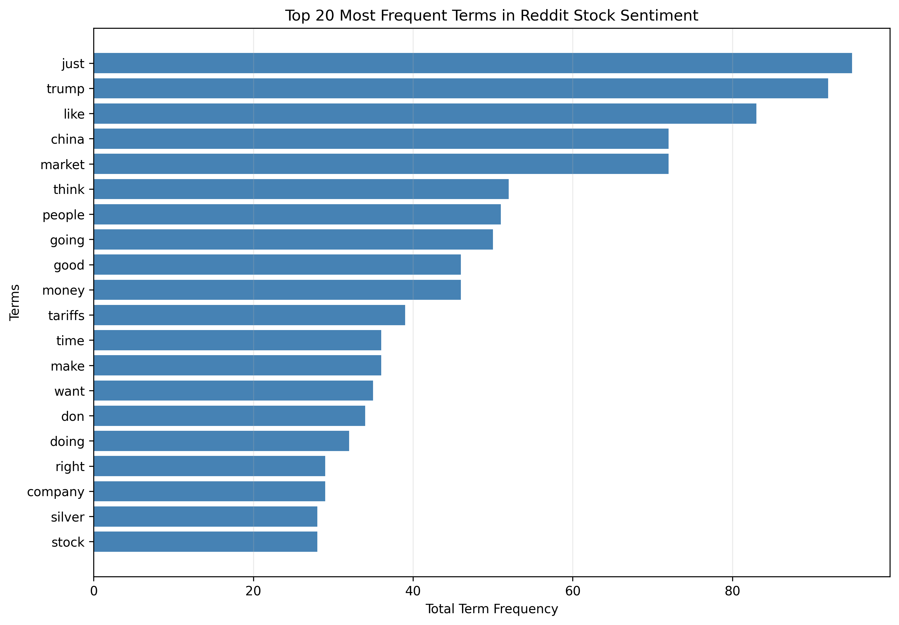

# Data Mining Lab 1 — Homework Report

**Student:** 許常樂
**Student ID:** 115368516
**Dataset:** Reddit Stock Sentiment

## 1. Dataset and Preprocessing

The Reddit Stock Sentiment dataset originally contained 847 documents. I used the data mining agent and student-developed tools to inspect the dataset, check for missing values, remove duplicates, tokenize text, and construct a Document-Term Matrix (DTM). The missing-value check found no missing values. Duplicate removal eliminated 34 rows, leaving 813 documents. The cleaned dataset contains text, sentiment labels, numerical categories, and tokenized unigrams.

## 2. Sentiment Distribution

Among the 813 cleaned documents, 315 were negative (38.75%), 391 were neutral (48.09%), and 107 were positive (13.16%). Neutral sentiment was the largest category, while positive sentiment was the smallest. This class imbalance should be considered when interpreting results or training sentiment classification models.

## 3. Document-Term Matrix and Term Frequencies

I constructed a DTM using a minimum document frequency of 2, maximum document frequency of 0.95, unigrams, a maximum of 3,000 features, and English stopword removal. The resulting sparse matrix contained 813 documents and 1,441 terms, with 6,875 nonzero entries and approximately 99.41% sparsity.

Using the agent's term_frequency_tool, I identified the most frequent terms. The top five were 'just' (95), 'trump' (92), 'like' (83), 'market' (72), and 'china' (72). These terms suggest that discussions included market conditions, politics, and economic events.

## 4. Document Similarity

I used the agent's cosine_similarity_tool to compare documents at indices 0 and 1. Their cosine similarity was 0.0, indicating that the two documents did not share any terms represented in the current DTM. This result applies to the processed text representation and does not necessarily imply that their original texts had no words in common.

## 5. Conclusion

This Homework demonstrated how agent-executed data mining tools can support text preprocessing, feature extraction, frequency analysis, and document similarity measurement. The results revealed an imbalanced sentiment distribution and a highly sparse DTM. The frequent terms also provided a basic understanding of topics discussed in the Reddit stock-related posts.
